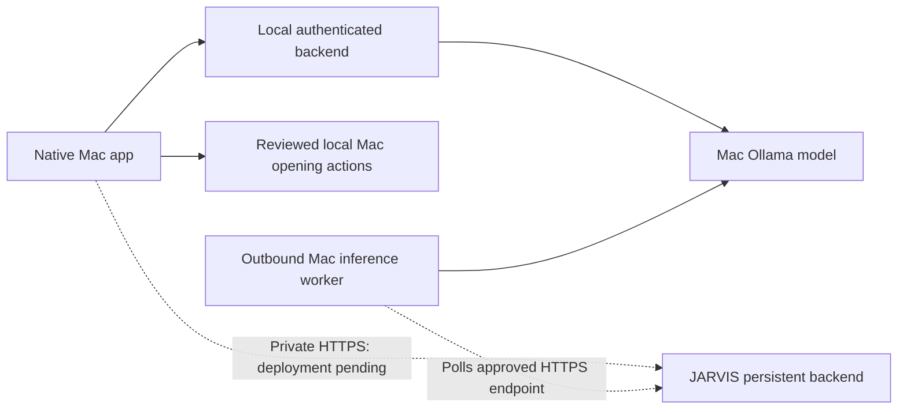

# Personal Codex

[](https://github.com/SamarthRamesha/personal-codex/actions/workflows/verify.yml)

A local-first AI development workspace for your Mac, with a native application, reviewed coding actions, persistent history and a prepared private home-server backend.

**Current integration status — 28 November 2026:** real local-model coding and a supplied-baseline web calculator passed on the ARM64 Mac. Reviewed locked npm installation, owned plain-Node previews and isolated desktop chat have direct acceptance evidence. General Mac automation, broader framework support, JARVIS deployment and notarized distribution still have open gates. Stable main has not been changed by this debugging session. [Current evidence and limits](docs/PRODUCT_COMPLETION.md)

## Start here

- [Getting started](docs/GETTING_STARTED.md) — run the prepared Mac app or build from source.
- [What works and what remains](docs/IMPLEMENTATION_MATRIX.md) — current evidence and limits.
- [Mac automation preview](docs/MAC_AUTOMATION.md) — reviewed cross-app controls; actual UI acceptance pending.
- [Mac actions](docs/MAC_ACTIONS.md) — applications, documents and Finder, with one-use review.
- [Home-server integration](DEPLOYMENT.md) — architecture, required controls and deployment gates.
- [Documentation index](docs/README.md) — developer, security and operations guides.

## What you can do

| Capability | Available now |
|---|---|
| Local conversations | Persisted history, model selection, streaming, stop and retry |
| Coding tasks | Plan, edit an isolated Git worktree, test, repair and review results |
| Full-task delivery | Deliver verified files to an approved project; preserve conflicting changes |
| Project references | Import selected local excerpts, explicitly add them to search, inspect attribution and remove them |
| Mac actions | Review and open an installed app or selected document; reveal a selected file/folder in Finder |
| Dependencies | Review exact locked npm packages, confirm downloads, install with lifecycle scripts disabled |
| Development preview | Review a declared plain-Node entry; start/stop one owned loopback listener |
| Local inference | Existing Ollama models; no silent cloud fallback or automatic model downloads |
| Home-server backend | Worker protocol and restricted deployment profile implemented; actual JARVIS installation pending |

Mac actions currently open destinations. They do **not** click through arbitrary applications, read your screen, type into other apps, run arbitrary system commands or autonomously operate every Mac workflow. The separate [Mac automation preview](docs/MAC_AUTOMATION.md) now implements bounded native controls and local plan review, but real UI acceptance is still pending. Those capabilities are not implied by the opening panel.

## Run on the prepared Mac

From this checkout:

```sh
python3 scripts/offline_workstation.py
```

Choose **Connect backend** for local coding and chat. The launcher selects the newest available reviewed bundle, preferring the source-built integration candidate, then `data/mac-actions-app/Personal Codex.app`, and uses the existing local model cache. Compiled bundles and private profiles are intentionally excluded from Git.

The launcher manages its own loopback services. If another Ollama or Personal Codex instance already owns its ports, it stops with an explanation; it does not kill or reconfigure your existing service. Add `--reuse-ollama` explicitly to use an already running loopback Ollama without managing it. **Mac actions** can also be used directly in the built native app without connecting a backend.

For another machine, follow the [source-build guide](docs/GETTING_STARTED.md). The repository does not include models or a portable signed installer.

## How it fits together



The Python backend owns approvals, persistence and task state. The native bridge owns selected local capabilities. A remote backend cannot use the Mac opening commands. The proposed server profile keeps repository execution disabled and inference worker-only until separate acceptance allows more.

## Verification

Current Mac regression: **505 passed, 5 skipped, 510 discovered**. Frontend: **101 passed** plus TypeScript/Vite build. Native Rust: **14 passed, one ignored**. Integration [CI #129](https://github.com/SamarthRamesha/personal-codex/actions/runs/46147661571) passed all jobs. Hosted tests use scripted inference; installed-model and GUI evidence is recorded separately.

Real qwen3.5:9b repair and a web calculator from supplied manifest/independent tests passed. Actual desktop settings, opening proposal/cancel, dependency installation, preview readiness and chat controls were exercised. Product cross-app automation still requires owner permission/acceptance; no universal coding or system-automation success is claimed. [Acceptance inventory](docs/PRODUCT_COMPLETION.md)

## Privacy and boundaries

Project access and changes stay within approved scope. Exact approvals, stale-file checks, cancellation and explicit resume preserve user changes. Imported text remains untrusted. Default logs and model metrics avoid adding prompt or credential payloads. No telemetry or silent cloud routing is enabled by the local-first profile.

A personal Mac is a trusted local environment, not a complete hostile multi-user sandbox. Server deployment, whole-volume quotas, production-scale encrypted recovery, notarized distribution and general cross-app automation remain unfinished. Read the [security policy](SECURITY.md) and [threat model](docs/THREAT_MODEL.md).

## Contributing and checking

See [CONTRIBUTING.md](CONTRIBUTING.md). Python backend tests use the standard library; frontend and native builds use their committed lockfiles. Optional integrations remain optional. Never commit runtime profiles, credentials, model files, private server inventory or personal documents.
