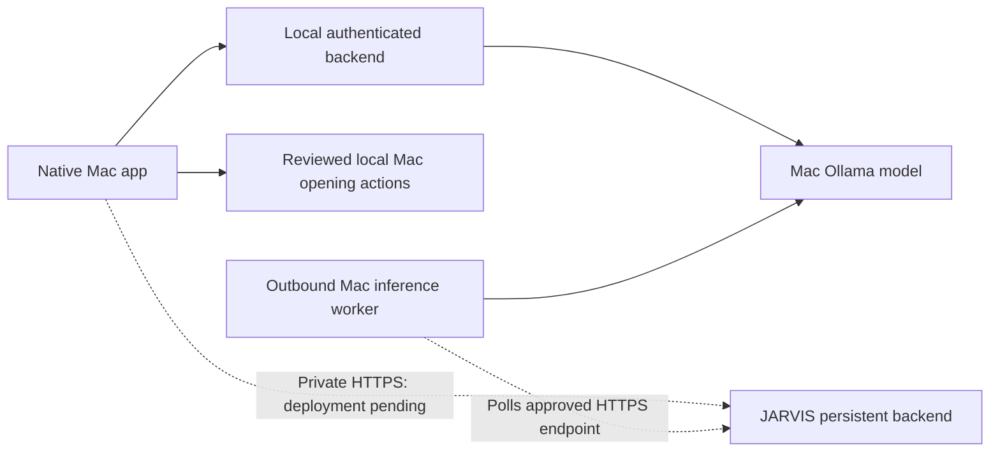

# Personal Codex

[](https://github.com/SamarthRamesha/personal-codex/actions/workflows/verify.yml)

A local-first AI development workspace for your Mac, with a native application, reviewed coding actions, persistent history and a prepared private home-server backend.

**Current status — 20 November 2026:** the Mac coding workflow works locally. Document search, bounded repair loops and a first set of local Mac opening actions are implemented. The JARVIS deployment is **not live**; private HTTPS, remote inference and family-access preservation still need target verification and exact deployment approvals.

## Start here

- [Getting started](docs/GETTING_STARTED.md) — run the prepared Mac app or build from source.
- [What works and what remains](docs/IMPLEMENTATION_MATRIX.md) — current evidence and limits.
- [Mac actions](docs/MAC_ACTIONS.md) — applications, documents and Finder, with one-use review.
- [Home-server integration](DEPLOYMENT.md) — architecture, required controls and deployment gates.
- [Documentation index](docs/README.md) — developer, security and operations guides.

## What you can do

| Capability | Available now |
|---|---|
| Local conversations | Persisted history, model selection, streaming, stop and retry |
| Coding tasks | Plan, edit an isolated Git worktree, test, repair and review results |
| Full-task delivery | Deliver verified files to an approved project; preserve conflicting changes |
| Project references | Import selected local excerpts, explicitly add them to search, inspect attribution and remove them |
| Mac actions | Review and open an installed app or selected document; reveal a selected file/folder in Finder |
| Local inference | Existing Ollama models; no silent cloud fallback or automatic model downloads |
| Home-server backend | Worker protocol and restricted deployment profile implemented; actual JARVIS installation pending |

Mac actions currently open destinations. They do **not** click through arbitrary applications, read your screen, type into other apps, run arbitrary system commands or autonomously operate every Mac workflow. Those are separate capabilities, not implied by the opening panel.

## Run on the prepared Mac

From this checkout:

```sh
python3 scripts/offline_workstation.py
```

Choose **Connect backend** for local coding and chat. The launcher selects the newest available reviewed bundle, preferring `data/mac-actions-app/Personal Codex.app`, and uses the existing local model cache. Compiled bundles and private profiles are intentionally excluded from Git.

The launcher manages its own loopback services. If another Ollama or Personal Codex instance already owns its ports, it stops with an explanation; it does not kill or reconfigure your existing service. **Mac actions** can also be used directly in the built native app without connecting a backend.

For another machine, follow the [source-build guide](docs/GETTING_STARTED.md). The repository does not include models or a portable signed installer.

## How it fits together



The Python backend owns approvals, persistence and task state. The native bridge owns selected local capabilities. A remote backend cannot use the Mac opening commands. The proposed server profile keeps repository execution disabled and inference worker-only until separate acceptance allows more.

## Verification

Latest local backend regression: **372 passed, 5 skipped, 377 discovered**. Latest frontend: **14 passed** plus TypeScript/Vite build. Native Rust: **7 passed** plus optimized app build. Exact backend source `282b90d` passed **17 container checks** in a separate disposable Linux machine, including nonroot/resource/read-only controls, authentication, no-connect policy, document search and restart persistence. This is not JARVIS runtime proof.

Real installed-model CLI and existing-project ML repair were exercised earlier; see [ML acceptance](docs/ML_WORKFLOW_ACCEPTANCE.md) for the authored scaffold, failures, independent tests and limits. The newest Mac actions UI could not be visually verified because the UI connector stalled; native policy tests and the build passed. No universal coding or system-automation success is claimed.

[GitHub Actions](.github/workflows/verify.yml) runs isolated backend, frontend and native checks without private server credentials, models or a JARVIS connection. The [verified hosted run](https://github.com/SamarthRamesha/personal-codex/actions/runs/44749454322) passed all three jobs; hosted optional/platform skips differ from the prepared Mac.

## Privacy and boundaries

Project access and changes stay within approved scope. Exact approvals, stale-file checks, cancellation and explicit resume preserve user changes. Imported text remains untrusted. Default logs and model metrics avoid adding prompt or credential payloads. No telemetry or silent cloud routing is enabled by the local-first profile.

A personal Mac is a trusted local environment, not a complete hostile multi-user sandbox. Server deployment, whole-volume quotas, production-scale encrypted recovery, notarized distribution and general cross-app automation remain unfinished. Read the [security policy](SECURITY.md) and [threat model](docs/THREAT_MODEL.md).

## Contributing and checking

See [CONTRIBUTING.md](CONTRIBUTING.md). Python backend tests use the standard library; frontend and native builds use their committed lockfiles. Optional integrations remain optional. Never commit runtime profiles, credentials, model files, private server inventory or personal documents.
